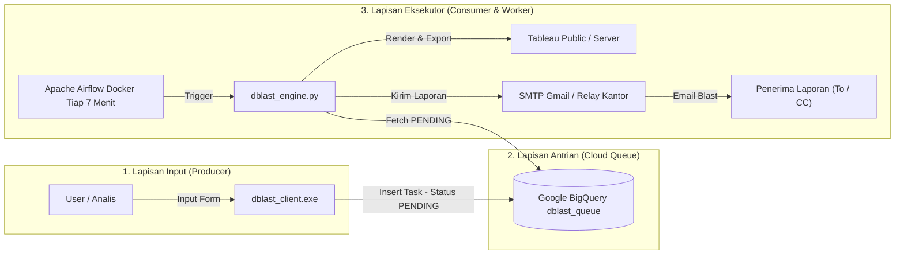

# Dokumentasi Lengkap & Panduan Operasional Sistem DBlast
*(Automated Tableau Dashboard & Email Blasting System)*

---

## Daftar Isi
1. [Bab 1: Pendahuluan & Gambaran Arsitektur](#bab-1-pendahuluan--gambaran-arsitektur)
2. [Bab 2: Prasyarat, Virtual Environment, & Instalasi Library](#bab-2-prasyarat-virtual-environment--instalasi-library)
3. [Bab 3: Panduan Kompilasi & Pembuatan File .exe](#bab-3-panduan-kompilasi--pembuatan-file-exe)
4. [Bab 4: Panduan Menjalankan Sistem (Airflow & Docker)](#bab-4-panduan-menjalankan-sistem-airflow--docker)
5. [Bab 5: Cara Kerja Sistem di Balik Layar (Backend Mechanism)](#bab-5-cara-kerja-sistem-di-balik-layar-backend-mechanism)
6. [Bab 6: Buku Panduan Pengguna Akhir (User Manual)](#bab-6-buku-panduan-pengguna-akhir-user-manual)
7. [Bab 7: Pemeliharaan & Troubleshooting](#bab-7-pemeliharaan--troubleshooting)

---

## Bab 1: Pendahuluan & Gambaran Arsitektur

### 1.1 Latar Belakang
**DBlast (Dashboard Blasting)** adalah sistem otomatisasi yang dirancang untuk mengeliminasi pekerjaan repetitif dalam pengiriman laporan harian/mingguan dari Tableau ke email pengguna. Sistem ini memungkinkan analis mendistribusikan visualisasi dashboard (dalam bentuk gambar body email, lampiran Excel dengan gambar tersemat, atau dokumen PDF) secara terjadwal dan otomatis tanpa intervensi manual setiap hari.

### 1.2 Tiga Pilar Arsitektur DBlast



1. **Lapisan Input (*Producer*)**: Aplikasi executable (`dblast_client.exe`) yang dibagikan ke pengguna untuk mendaftarkan jadwal laporan yang diinginkan.
2. **Lapisan Antrian (*Cloud Queue*)**: Google BigQuery (`dblast_data.dblast_queue`) yang bertindak sebagai antrian pesan terpusat yang aman dan terisolasi.
3. **Lapisan Eksekusi & Orkestrasi (*Consumer & Worker*)**: Apache Airflow di dalam kontainer Docker yang secara berkala (setiap 7 menit) mengecek antrian, mengambil data visual Tableau, merakit lampiran, dan mengirimkannya via email.

---

## Bab 2: Prasyarat, Virtual Environment, & Instalasi Library

### 2.1 Software yang Wajib Terpasang
Sebelum memulai pengembangan atau pengujian backend, pastikan komputer Anda telah terinstal:
* **Python 3.11+**: Interpreter bahasa pemrograman Python ([Download Python](https://www.python.org/downloads/)).
* **Docker Desktop**: Platform kontainerisasi untuk menjalankan Apache Airflow ([Download Docker Desktop](https://www.docker.com/products/docker-desktop/)).
* **Google Cloud SDK (gcloud CLI)**: Untuk autentikasi awal Google Cloud BigQuery.

---

### 2.2 Penjelasan & Penggunaan Virtual Environment (`venv`)

#### Mengapa Kita Menggunakan Virtual Environment?
> [!NOTE]
> **Virtual Environment (venv) berfungsi untuk:**
> 1. **Isolasi Pustaka (Library)**: Mencegah terjadinya konflik versi antara paket yang dibutuhkan proyek DBlast dengan proyek Python lain yang ada di laptop Anda.
> 2. **Menjaga Kerapian Sistem Global**: Semua paket yang diunduh hanya akan berada di dalam folder proyek ini saja, tidak mencemari instalasi Python utama Windows.
> 3. **Memudahkan Replikasi**: Memastikan tim lain yang menjalankan proyek ini menggunakan daftar dependensi yang seragam dan bersih.

#### Cara Membuat dan Mengaktifkan `venv` di Command Prompt (CMD)

Buka **Command Prompt (CMD)** atau **PowerShell**, arahkan ke direktori proyek DBlast, lalu ketik perintah berikut:

1. **Membuat Virtual Environment Baru:**
   ```cmd
   cd C:\Users\rifqi\Documents\Magang_cimb\Tableau\dblast
   python -m venv venv
   ```
   *Perintah di atas akan menciptakan folder baru bernama `venv` yang berisi salinan mandiri dari interpreter Python.*

2. **Mengaktifkan Virtual Environment:**
   * Di **Command Prompt (CMD)**:
     ```cmd
     venv\Scripts\activate
     ```
   * Di **PowerShell**:
     ```powershell
     .\venv\Scripts\Activate.ps1
     ```
   *Tanda jika venv sudah aktif: Di sebelah kiri baris perintah terminal Anda akan muncul tanda prefix `(venv)` seperti ini:*
   ```text
   (venv) C:\Users\rifqi\Documents\Magang_cimb\Tableau\dblast>
   ```

3. **Cara Menonaktifkan (Keluar dari) Virtual Environment:**
   Jika sudah selesai bekerja dan ingin keluar dari isolasi venv, cukup ketik:
   ```cmd
   deactivate
   ```

---

### 2.3 Penjelasan & Fungsi Setiap Paket Pustaka (`pip install`)

Setelah virtual environment aktif, lakukan instalasi pustaka-pustaka yang diperlukan. Setiap paket memiliki peran krusial dalam sistem DBlast:

#### 1. `pip install google-cloud-bigquery`
* **Berfungsi untuk**: Menghubungkan script Python ke layanan Google Cloud BigQuery. Pustaka ini digunakan oleh `dblast_client.py` untuk mengunggah antrian tugas baru (*Load Job*), serta digunakan oleh `dblast_engine.py` untuk membaca query antrian yang berstatus `PENDING`.

#### 2. `pip install openpyxl`
* **Berfungsi untuk**: Membuat, membaca, memanipulasi, dan menyimpan file spreadsheet Microsoft Excel (`.xlsx`). Paket ini digunakan oleh engine saat menyusun file Excel laporan Tableau.

#### 3. `pip install pillow`
* **Berfungsi untuk**: Memproses dan memanipulasi citra/gambar digital (Python Imaging Library). Pustaka ini **wajib** ada agar `openpyxl` mampu menyisipkan dan menyematkan gambar tangkapan layar dashboard Tableau secara visual ke dalam lembar kerja (*worksheet*) Excel.

#### 4. `pip install python-dotenv`
* **Berfungsi untuk**: Membaca variabel konfigurasi sensitif dari file `.env` (seperti `SENDER_EMAIL`, `APP_PASSWORD`, dan `PIC_EMAIL`) ke dalam sistem (*environment variables*) secara otomatis, sehingga kredensial rahasia tidak perlu ditulis langsung (*hardcoded*) di dalam script kode.

#### 5. `pip install requests`
* **Berfungsi untuk**: Melakukan panggilan protokol HTTP/HTTPS (GET request) ke endpoint Tableau Public / Tableau Server untuk mengunduh file gambar PNG resolusi tinggi dan dokumen PDF dari dashboard laporan yang diminta.

#### 6. `pip install pyinstaller`
* **Berfungsi untuk**: Mengompilasi dan mengemas (*packaging*) script Python (`dblast_client.py`) beserta interpreter dan seluruh dependensinya menjadi **satu file executable tunggal (`.exe`)** yang dapat langsung dijalankan di komputer Windows pengguna lain tanpa mereka harus memasang Python.

#### Perintah Instalasi Sekaligus:
```cmd
pip install google-cloud-bigquery openpyxl pillow python-dotenv requests pyinstaller
```

---

## Bab 3: Panduan Kompilasi & Pembuatan File .exe

### 3.1 Mengapa Dibuat Menjadi File .exe?
Pengguna akhir umumnya tidak memiliki lingkungan pemrograman Python di laptop kantor mereka. Dengan mengompilasi program input client menjadi file `.exe`, pengguna cukup melakukan **klik dua kali** untuk membuka antarmuka terminal DBlast.

### 3.2 Langkah-Langkah Pembuatan `.exe` dengan PyInstaller

1. Pastikan virtual environment Anda sedang **aktif** (`(venv)`).
2. Jalankan perintah kompilasi satu file (*standalone executable*):
   ```cmd
   pyinstaller --onefile dblast_client.py
   ```
   *Atau jika ingin menggunakan konfigurasi spesifikasi yang sudah disesuaikan:*
   ```cmd
   pyinstaller dblast_client.spec
   ```
3. PyInstaller akan memproses kompilasi:
   * Menganalisis seluruh import modul.
   * Menghasilkan folder sementara `build/`.
   * Menghasilkan file cetak biru `dblast_client.spec`.
4. **Hasil File Executable**:
   Setelah proses selesai dengan tulisan `Building EXE successfully`, file jadi akan berada di folder:
   ```text
   C:\Users\rifqi\Documents\Magang_cimb\Tableau\dblast\dist\dblast_client.exe
   ```
5. File `dist\dblast_client.exe` inilah yang disalin dan dibagikan ke seluruh user.

---

## Bab 4: Panduan Menjalankan Sistem (Airflow & Docker)

Sistem backend worker DBlast diorkestrasikan oleh **Apache Airflow 2.8.1** yang berjalan di dalam kontainer Docker.

### 4.1 Menyalakan Kontainer Docker
Buka terminal di root direktori proyek, lalu jalankan:
```cmd
docker compose up -d
```
*Perintah ini akan menyalakan kontainer bernama `dblast-airflow` dalam mode background.*

### 4.2 Memeriksa Status Kontainer
Pastikan kontainer berjalan normal dengan perintah:
```cmd
docker ps
```
Dan periksa log inisialisasi:
```cmd
docker logs --tail 30 dblast-airflow
```

### 4.3 Mengakses Airflow Web UI
Buka web browser dan akses dashboard kontrol Airflow:
* **URL:** `http://localhost:8080`
* **Username:** `airflow`
* **Password:** `airflow`
* **Zona Waktu Tampilan:** `Asia/Jakarta (WIB)` (sudah disinkronkan ke zona waktu lokal Indonesia).

### 4.4 Mengaktifkan Pipeline DAG
Di halaman utama Airflow (*DAGs list*):
1. Cari nama DAG: **`dblast_automation_pipeline`**.
2. Pastikan tombol sakelar (*toggle*) di sebelah kiri nama DAG berada pada posisi **ON (Warna Biru / Unpaused)**.
3. Airflow kini akan aktif secara terjadwal memeriksa antrian BigQuery setiap 7 menit.

---

## Bab 5: Cara Kerja Sistem di Balik Layar (Backend Mechanism)

Berikut adalah siklus operasional yang berlangsung otomatis setiap siklus 7 menit:

```mermaid
flowchart LR
    subgraph Phase1 ["1. Pemicu Jadwal (Triggering)"]
        AIR["Airflow Scheduler<br/>(Cron: */7 menit)"] -->|Otomatis Panggil| ENG["dblast_engine.py"]
    end

    subgraph Phase2 ["2. Pemeriksaan Antrian (Queue Check)"]
        ENG -->|Query Task PENDING| BQ[("Google BigQuery<br/>dblast_queue")]
        BQ -->|Daftar Task Masuk| CHK{"Cek ID di<br/>processed_tasks.txt"}
    end

    subgraph Phase3 ["3. Filter Idempotensi (Safety Net)"]
        CHK -->|Ya: Sudah Ada| SKIP["[SKIP] Abaikan<br/>(Cegah Email Dobel)"]
        CHK -->|Tidak: Task Baru| PROC["Lanjut Proses Laporan"]
    end

    subgraph Phase4 ["4. Ekstraksi Data (Rendering)"]
        PROC -->|Fetch Gambar & PDF| TAB["Tableau Server / Public"]
        PROC -->|Rakit Excel & Embed Visual| XL["OpenPyXL & Pillow"]
    end

    subgraph Phase5 ["5. Pengiriman Laporan (Email Delivery)"]
        TAB & XL -->|Kirim Laporan + Lampiran| SMTP["SMTP Server (Gmail / Relay)"]
        SMTP -->|Email Laporan| REC["Penerima (To, CC, BCC)"]
        SMTP -->|Notifikasi Terdaftar| PIC["Inbox PIC Sistem"]
    end

    subgraph Phase6 ["6. Penyelesaian Task (Finalizing)"]
        REC & PIC -->|Catat ID Task Sukses| LOG[("processed_tasks.txt<br/>(Kunci Lokal)")]
        LOG -->|Update status: DONE| BQ
    end
```



### 5.1 Rincian 11 Tahapan Siklus Operasional Tiap 7 Menit

Berikut adalah penjelasan singkat mengenai 11 tahapan alur operasional otomatis di balik layar:

1. **Trigger Rutin**: Airflow Scheduler memicu eksekusi `dblast_engine.py` secara berkala setiap 7 menit sesuai jadwal cron `*/7 * * * *`.
2. **Cek Antrian (Query BigQuery)**: Engine mengirimkan perintah `SELECT * FROM dblast_queue WHERE status = 'PENDING' ORDER BY created_at ASC` ke BigQuery.
3. **Penerimaan Daftar Task**: BigQuery merespons dengan mengembalikan seluruh baris permintaan laporan yang masih berstatus `PENDING`.
4. **Validasi Idempotensi (State Check)**: Engine mencocokkan ID task dengan file log lokal `processed_tasks.txt`. Jika ID sudah ada, proses langsung di-*skip* agar tidak terjadi pengiriman email ganda.
5. **Ekstraksi Gambar Dashboard (.png)**: Jika task baru, engine melakukan HTTP GET request ke endpoint Tableau untuk mengunduh snapshot gambar visual dashboard resolusi tinggi.
6. **Ekstraksi Dokumen Laporan (.pdf)**: Engine mengunduh visualisasi laporan lengkap dalam bentuk berkas PDF dari endpoint Tableau.
7. **Perakitan File Excel (.xlsx)**: Menggunakan library `openpyxl` dan `Pillow`, engine membuat file spreadsheet Excel dan menyematkan gambar grafik dashboard langsung ke dalam lembar kerja (*worksheet*).
8. **Penyusunan Konten Email Multipart**: Engine merakit struktur email HTML dengan menyisipkan gambar dashboard di badan email (*CID inline image*) serta melampirkan file Excel, PDF, atau file lokal MISHARE.
9. **Pengiriman Email ke Penerima**: Engine membuka koneksi aman SSL (port 465) ke server SMTP Gmail/Relay kantor dan mengirimkan blast laporan ke alamat penerima (`To`, `CC`, `BCC`).
10. **Pengiriman Notifikasi ke PIC**: Engine mengirimkan email notifikasi konfirmasi ke PIC sistem (`PIC_EMAIL`) yang menyatakan bahwa laporan telah berhasil diproses dan dikirim ke pengguna.
11. **Pencatatan Status Selesai**: Engine mencatat ID task ke dalam file `processed_tasks.txt` (pengunci lokal) dan mencoba mengeksekusi query BigQuery `UPDATE status = 'DONE'` untuk menandai antrian selesai.

---

### 5.2 Struktur Tabel & Fungsi Kolom Google BigQuery (`dblast_queue`)

Tabel antrian `project-raka-485012.dblast_data.dblast_queue` di Google BigQuery memiliki skema kolom sebagai berikut:

| No | Nama Kolom | Tipe Data | Fungsi & Penjelasan |
|:---:|---|:---:|---|
| **1** | `id` | STRING | **Primary Key unik (UUID v4)** yang dibuat secara otomatis oleh client untuk membedakan setiap task laporan agar tidak tertukar. |
| **2** | `output_option` | STRING | **Kode pilihan format output (1–9)** yang dipilih user (misal: hanya gambar body, gambar + Excel, gambar + PDF, attachment look up MISHARE, dll). |
| **3** | `report_key` | STRING | **Kata kunci/nama alias laporan** (contoh: `US_Flight_Report` atau `Daily_Sales_MIS`), digunakan sebagai identitas laporan pada subjek email dan nama lampiran default. |
| **4** | `workbook_url` | STRING | **Alamat path Workbook/Sheet Tableau** yang ingin diekstraksi visualisasinya (contoh: `Superstore/Overview`). |
| **5** | `local_file_path` | STRING | **Alamat path file lokal/jaringan (MISHARE)** jika user memilih opsi 8 atau 9 untuk melampirkan dokumen tambahan dari folder bersama. |
| **6** | `custom_tableau_name` | STRING | **Nama kustom file lampiran Tableau**, diisi jika user ingin memberi nama file lampiran Excel/PDF berbeda dari nama default Tableau. |
| **7** | `custom_local_name` | STRING | **Nama kustom file lampiran lokal**, diisi jika user ingin mengganti nama file lampiran MISHARE saat terkirim ke email. |
| **8** | `filter_params` | STRING (JSON) | **Data filter dashboard dalam format JSON string** (contoh: `{"Region": "West", "Year": "2024"}`), yang akan disisipkan ke URL Tableau saat pengunduhan data. |
| **9** | `email_to` | STRING | **Daftar alamat email penerima utama**, dipisahkan dengan tanda koma jika penerima lebih dari satu orang. |
| **10** | `email_cc` | STRING | **Daftar alamat email tembusan (Carbon Copy)** yang akan menerima salinan laporan. |
| **11** | `email_bcc` | STRING | **Daftar alamat email tembusan tersembunyi (Blind Carbon Copy)**. |
| **12** | `email_subject` | STRING | **Judul subjek email** yang akan tampil di inbox penerima laporan. |
| **13** | `status` | STRING | **Status pemrosesan tugas**, bernilai `PENDING` saat baru didaftarkan oleh user, dan akan beralih ke `DONE` saat telah sukses dieksekusi. |
| **14** | `created_at` | TIMESTAMP | **Waktu dan tanggal pendaftaran request** dalam format ISO 8601 UTC, digunakan untuk mengurutkan antrian tugas secara kronologis (*FIFO - First In First Out*). |

---

### 5.3 Mekanisme Idempotensi & Proteksi Akun Free Tier
> [!IMPORTANT]
> **Mengapa diperlukan `processed_tasks.txt`?**
> Pada akun Google Cloud **BigQuery Sandbox / Free Tier**, perintah DML seperti `UPDATE` dilarang. Agar sistem tidak mengirim email yang sama berulang kali setiap 7 menit karena status BigQuery tidak bisa diubah dari `PENDING`, sistem DBlast dilengkapi file lokal **`processed_tasks.txt`**.
>
> Begitu task berhasil dikirim, engine langsung mencatat ID task tersebut ke file log lokal. Setiap siklus berjalan, engine selalu membandingkan ID antrian dengan log ini. Jika sudah pernah dikirim, task langsung dilewati (*skipped*).

---

## Bab 6: Buku Panduan Pengguna Akhir (User Manual)

Bagian ini adalah Standar Operasional Prosedur (SOP) bagi rekan kerja atau staf yang menggunakan aplikasi `dblast_client.exe`.

### 6.1 Memulai Program
1. Klik dua kali pada file `dblast_client.exe`.
2. Jendela terminal interaktif akan terbuka menyajikan menu pilihan.

---

### 6.2 Memilih Format Output (Opsi 1–9)

| Nomor Opsi | Format Komponen yang Dikirimkan | Keterangan Penggunaan |
|:---:|---|---|
| **1** | Only Sheet 1 | Gambar dashboard disisipkan langsung di badan email (*body image*). |
| **2** | Sheet 1 + Sheet 2 | Gambar di badan email **+** Lampiran Workbook Excel (.xlsx). |
| **3** | Sheet 1 + Sheet 3 | Gambar di badan email **+** Lampiran Dokumen Laporan PDF (.pdf). |
| **4** | Sheet 1 + Sheet 2 + Sheet 3 | Paket Lengkap: Gambar di badan email **+** Excel **+** PDF. |
| **5** | Only Sheet 2 | Hanya mengirimkan lampiran Excel (.xlsx). |
| **6** | Sheet 2 + Sheet 3 | Lampiran Excel (.xlsx) **+** Lampiran PDF (.pdf). |
| **7** | Only Sheet 3 | Hanya mengirimkan lampiran PDF (.pdf). |
| **8** | Attachment Look up | Mengirimkan file lampiran dokumen yang sudah ada di folder bersama (*MISHARE*). |
| **9** | Sheet 1 + Attachment Look up | Gambar dashboard di badan email **+** file dari folder bersama. |

---

### 6.3 Mengisi Parameter Laporan
Pengguna akan dipandu memasukkan data satu per satu:

1. **Output Option**: Masukkan angka `1` sampai `9`.
2. **Report Key**: Masukkan kata kunci nama laporan (contoh: `US_Flight_Report` atau `Daily_Sales_MIS`).
3. **Tableau Workbook/Sheet Path**:
   * Masukkan path sheet Tableau (contoh: `Superstore/Overview`).
4. **Filter Settings (Opsional)**:
   * Masukkan nama parameter filter (misal: `Region`), lalu tekan ENTER.
   * Masukkan nilai filternya (misal: `West`).
   * Jika tidak ada filter lagi, langsung tekan **ENTER** pada prompt nama filter untuk melanjutkan.
5. **Email Settings**:
   * **To**: Masukkan alamat email tujuan (pisahkan dengan koma jika lebih dari satu).
   * **CC / BCC**: Masukkan email tembusan (atau tekan ENTER jika tidak ada).
   * **Subject**: Masukkan judul email laporan.

---

### 6.4 Konfirmasi Pengiriman
Setelah semua data diisi, sistem akan menampilkan:
```text
[SYSTEM] Sending request to BigQuery Queue...
[SUCCESS] Your report request has been queued successfully!
[INFO] The engine will process and send your email shortly.

Press ENTER to close this window...
```
*Laporan akan dieksekusi secara otomatis oleh Airflow pada siklus 7 menit berikutnya.*

---

## Bab 7: Pemeliharaan & Troubleshooting

| Gejala Masalah | Penyebab Umum | Solusi Perbaikan |
|---|---|---|
| **Airflow Web UI tidak bisa dibuka di browser (`localhost:8080`)** | Kontainer Docker mati atau belum dijalankan. | Buka terminal dan jalankan `docker compose up -d`. Periksa kesehatan kontainer dengan `docker ps`. |
| **Status login Airflow: `Invalid login. Please try again`** | Kontainer sempat dibuat ulang (*recreated*) sehingga database lokal ter-reset. | Jalankan perintah di terminal untuk mendaftarkan ulang user:<br>`docker exec dblast-airflow airflow users create -u airflow -p airflow -f Airflow -l Admin -r Admin -e airflow@example.com` |
| **Error `google.auth.exceptions.DefaultCredentialsError`** | Kontainer Airflow tidak dapat menemukan kredensial Google Cloud. | Pastikan file kredensial `.gcloud_adc.json` ada di root direktori proyek dan variabel `GOOGLE_APPLICATION_CREDENTIALS` sudah terpasang di `docker-compose.yaml`. |
| **Error `ModuleNotFoundError: No module named 'Pillow'`** | Library pemroses gambar belum terpasang di image Python Airflow. | Pastikan parameter `_PIP_ADDITIONAL_REQUIREMENTS` pada `docker-compose.yaml` menyertakan `pillow openpyxl google-cloud-bigquery python-dotenv requests`. |
| **Email terkirim berkali-kali pada akun Free Tier** | ID task belum tercatat di file log lokal. | Tambahkan ID task yang bersangkutan ke dalam file `processed_tasks.txt`. |
