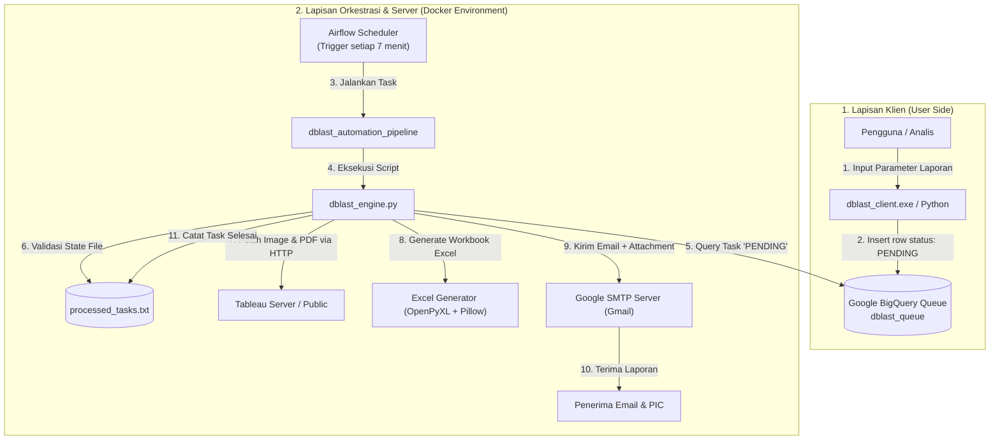
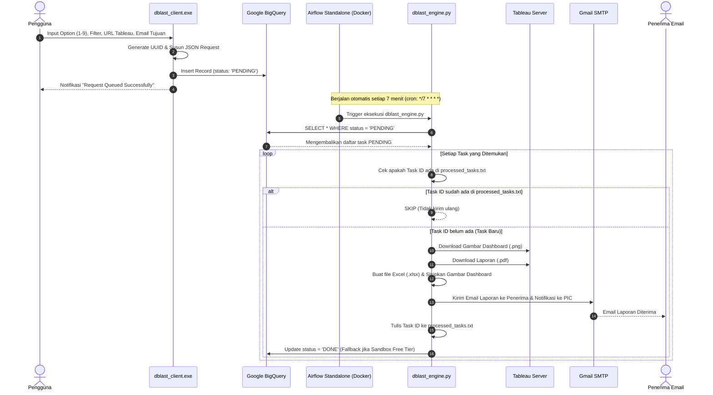

# Dokumentasi Lengkap Sistem DBlast (Dashboard Blasting Automation)

Dokumen ini menjelaskan arsitektur, daftar berkas, fungsi tiap komponen, serta alur kerja *end-to-end* sistem automasi **DBlast** yang dibangun untuk pengiriman laporan Tableau via email berbasis antrian cloud dan orkestrasi Airflow.

---

## 1. Arsitektur dan Alur Kerja Sistem

Sistem DBlast menggunakan arsitektur **asinkron berbasis antrian (*producer-consumer queue*)** yang dibagi menjadi 3 lapisan utama:
1. **Lapisan Input (*Producer*)**: Aplikasi client `.exe` yang diakses oleh pengguna.
2. **Lapisan Antrian (*Cloud Queue*)**: Google Cloud BigQuery yang menampung daftar antrian tugas secara terpusat.
3. **Lapisan Orkestrator & Eksekutor (*Consumer & Worker*)**: Apache Airflow di dalam Docker yang memicu pemrosesan antrian setiap interval 7 menit untuk membuat laporan dan mengirim email.



---

## 2. Diagram Sekuensial (*Step-by-Step Flow*)

Berikut adalah alur sekuensial interaksi antar komponen saat ada permintaan laporan baru:



---

## 3. Rincian Berkas dan Fungsinya

Berikut adalah seluruh berkas utama yang terdapat di dalam project `c:\Users\rifqi\Documents\Magang_cimb\Tableau\dblast`:

| No | Nama Berkas | Lokasi | Fungsi Utama |
|---|---|---|---|
| **1** | `dblast_client.py` | `./` (Root) | **Antarmuka Input Pengguna (CLI)**.<br>Menerima input pilihan output (1–9), parameter filter Tableau, email penerima, dan mengirim request baru ke BigQuery dengan status `PENDING`. |
| **2** | `dblast_client.spec` | `./` (Root) | **Konfigurasi Build PyInstaller**.<br>File spesifikasi untuk mengompilasi `dblast_client.py` menjadi file executable independen (`dblast_client.exe`) tanpa perlu instalasi Python di komputer user. |
| **3** | `dblast_engine.py` | `./` (Root) | **Backend Processing Engine (Core Worker)**.<br>Membaca antrian `PENDING` dari BigQuery, memverifikasi status log lokal, mengunduh visualisasi dari Tableau, menyusun file Excel dan PDF, merender template email, serta mengirimkannya via SMTP Gmail. |
| **4** | `dags/dblast_dag.py` | `./dags/` | **Definisi DAG Apache Airflow**.<br>Mengatur jadwal orkestrasi otomatis `*/7 * * * *` (setiap 7 menit), batas konkurensi (`max_active_runs=1`), serta memanggil `dblast_engine.py` melalui `BashOperator`. |
| **5** | `docker-compose.yaml` | `./` (Root) | **Konfigurasi Orkestrasi Container Docker**.<br>Menjalankan Airflow 2.8.1 dalam mode `standalone` (Webserver + Scheduler terintegrasi), mengatur zona waktu ke `Asia/Jakarta (WIB)`, memasang dependensi tambahan otomatis (`_PIP_ADDITIONAL_REQUIREMENTS`), dan melakukan *bind-mount* folder lokal ke container. |
| **6** | `.env` | `./` (Root) | **Konfigurasi Kredensial & Lingkungan**.<br>Menyimpan data sensitif seperti email pengirim (`SENDER_EMAIL`), App Password Gmail (`APP_PASSWORD`), dan email PIC notifikasi (`PIC_EMAIL`). |
| **7** | `.gcloud_adc.json` | `./` (Root) | **Kredensial Autentikasi Google Cloud (ADC)**.<br>Salinan kredensial Application Default Credentials dari komputer lokal yang di-mount ke dalam Docker container agar Airflow diizinkan membaca BigQuery. |
| **8** | `processed_tasks.txt` | `./` (Root) | **Pencatat Status Tugas Selesai (State File)**.<br>Mencatat seluruh `id` task yang emailnya telah berhasil dikirim. Berfungsi sebagai proteksi idempotensi (mencegah email dobel) pada BigQuery Free Tier. |
| **9** | `dblast_db/` | `./dblast_db/` | **Direktori Database Lokal**.<br>Folder cadangan metadata database SQLite untuk keperluan persistensi data Airflow. |

---

## 4. Penanganan Khusus BigQuery Free Tier (Solusi Anti-Spam Email)

> [!IMPORTANT]
> **Mengapa diperlukan `processed_tasks.txt`?**
> Pada Google Cloud BigQuery versi **Sandbox / Free Tier** (tanpa billing account aktif), Google **melarang perintah DML (`UPDATE`, `DELETE`)**.
> 
> Saat engine mencoba menjalankan perintah:
> ```sql
> UPDATE `project-raka-485012.dblast_data.dblast_queue` SET status = 'DONE' WHERE id = '...'
> ```
> BigQuery akan menolak query tersebut (`DML queries are not allowed in the free tier`). Jika status tetap `PENDING`, Airflow akan membaca kembali baris tersebut setiap 7 menit dan mengirim email yang sama tanpa henti.
> 
> **Mekanisme Solusi yang Diterapkan:**
> 1. Begitu email berhasil dikirim, engine mencatat `row.id` ke dalam file `processed_tasks.txt`.
> 2. Pada eksekusi berikutnya (7 menit kemudian), engine membaca file tersebut terlebih dahulu. Jika `row.id` ditemukan di file log, engine akan mengeluarkan pesan `[SYSTEM] Task ID ... already processed. Skipping.` dan **tidak mengirim email lagi**.
> 3. Jika di kemudian hari akun Google Cloud di-upgrade dengan mengaktifkan Billing Account, kode `UPDATE` di BigQuery akan otomatis aktif secara alami tanpa perlu merombak ulang sistem.

---

## 5. Ringkasan Kredensial dan Akses Layanan

* **Airflow Web UI**: `http://localhost:8080`
  * **Username:** `airflow`
  * **Password:** `airflow`
  * **Zona Waktu:** `Asia/Jakarta (WIB)`
* **Google BigQuery**:
  * **Project ID:** `project-raka-485012`
  * **Tabel Antrian:** `project-raka-485012.dblast_data.dblast_queue`
* **Email Gateway**:
  * **Protokol:** SMTP SSL (`smtp.gmail.com:465`)
  * **Akun Pengirim:** `raka58276@gmail.com`
