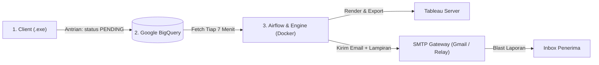

# DBlast - Automated Tableau Dashboard & Email Blasting

**DBlast (Dashboard Blasting)** adalah sistem otomatisasi berbasis antrian cloud (*cloud queue*) dan orkestrasi Airflow untuk mengekstraksi visualisasi dashboard Tableau secara terjadwal dan mengirimkannya secara otomatis ke email penerima.

---

## 🚀 Fitur Utama
* **Ekstraksi Visual Otomatis**: Mengunduh gambar dashboard Tableau beresolusi tinggi dan dokumen PDF via endpoint HTTP.
* **Perakitan Excel Interaktif**: Menyusun workbook Excel (`.xlsx`) dengan gambar grafik dashboard tertanam langsung menggunakan `openpyxl` & `Pillow`.
* **Dukungan File Jaringan (MISHARE)**: Mengirimkan dokumen lampiran lokal atau dari shared drive perusahaan.
* **Orkestrasi Asinkron Terjadwal**: Otomatisasi berjalan setiap 7 menit menggunakan **Apache Airflow** di dalam Docker.
* **Proteksi Idempotensi**: Mencegah pengiriman email ganda (*anti-spam*) yang kompatibel dengan akun Google BigQuery Free Tier maupun Billing aktif.

---

## 🏗️ Tiga Pilar Arsitektur



---

## ⚡ Quick Start

### 1. Prasyarat
* Python 3.11+
* Docker Desktop & Docker Compose
* Akun Google Cloud (BigQuery) & Kredensial SMTP

### 2. Setup Virtual Environment & Library
```bash
# Buat & aktifkan virtual environment
python -m venv venv
venv\Scripts\activate

# Install dependensi yang dibutuhkan
pip install google-cloud-bigquery openpyxl pillow python-dotenv requests pyinstaller
```

### 3. Menjalankan Server Backend (Airflow)
```bash
docker compose up -d
```
* **Airflow Web UI:** `http://localhost:8080`
* **Username / Password:** `airflow` / `airflow`
* **Timezone:** `Asia/Jakarta (WIB)`
* Pastikan DAG `dblast_automation_pipeline` dalam keadaan **ON (Unpaused)**.

### 4. Menjalankan / Mengompilasi Client (.exe)
* **Jalankan script langsung:**
  ```bash
  python dblast_client.py
  ```
* **Kompilasi menjadi file `.exe` mandiri untuk disebar ke pengguna:**
  ```bash
  pyinstaller --onefile dblast_client.py
  ```
  *(File hasil kompilasi akan berada di folder `dist/dblast_client.exe`)*

---

## 📚 Dokumentasi Rinci
Untuk mempelajari panduan operasional dan arsitektur lebih mendalam, silakan baca berkas dokumentasi berikut:
* **[DOKUMENTASI.md](DOKUMENTASI.md)**: Panduan instalasi lengkap, penjelasan `venv`, tabel antrian BigQuery, alur 11 tahapan operasional, dan manual penggunaan (opsi 1–9).
* **[PENJELASAN_4_FILE_UTAMA_DBLAST.md](PENJELASAN_4_FILE_UTAMA_DBLAST.md)**: Bedah baris kode dan fungsi dari `dblast_client.py`, `dblast_engine.py`, `dags/dblast_dag.py`, dan `docker-compose.yaml`.

---

## 👤 Pemilik Proyek
* **Pengembang**: Raka Arrayan Muttaqien
* **Organisasi**: MIS & Business Finance Group, PT Bank CIMB Niaga Tbk.
