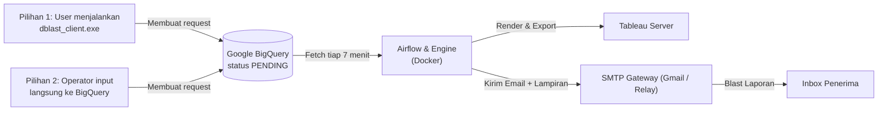

# DBlast - Automated Tableau Dashboard & Email Blasting

**DBlast (Dashboard Blasting)** adalah sistem otomatisasi berbasis antrian cloud (*cloud queue*) dan orkestrasi Airflow untuk mengekstraksi visualisasi dashboard Tableau secara terjadwal dan mengirimkannya secara otomatis ke email penerima.

---

## 🚀 Fitur Utama
* **Ekstraksi Visual Otomatis**: Mengunduh gambar dashboard Tableau beresolusi tinggi dan dokumen PDF via endpoint HTTP.
* **Perakitan Excel Interaktif**: Menyusun workbook Excel (`.xlsx`) dengan gambar grafik dashboard tertanam langsung menggunakan `openpyxl` & `Pillow`.
* **Dukungan File Jaringan (MISHARE)**: Mengirimkan dokumen lampiran lokal atau dari shared drive perusahaan.
* **Orkestrasi Asinkron Terjadwal**: Otomatisasi berjalan setiap 7 menit menggunakan **Apache Airflow** di dalam Docker.
* **Proteksi Idempotensi**: Mencegah pengiriman email ganda (*anti-spam*) yang kompatibel dengan akun Google BigQuery Free Tier maupun Billing aktif.

---

## 🏗️ Pilihan Arsitektur Input

DBlast menyediakan dua pilihan untuk memasukkan request:

1. **Menggunakan `dblast_client.exe`**: user mengisi form interaktif. Client
   kemudian membuat row request di BigQuery dengan `status = PENDING`.
2. **Input langsung ke BigQuery**: operator membuat row request secara manual
   di tabel BigQuery dengan `status = PENDING`, tanpa menjalankan client atau
   `.exe`.

Setelah request masuk ke BigQuery, kedua pilihan tersebut memakai alur backend
yang sama. Airflow di dalam Docker menjalankan DAG setiap 7 menit, lalu DAG
memanggil `dblast_engine.py` untuk mengambil dan memproses request.

## 📚 Dokumentasi Rinci
Untuk mempelajari panduan operasional dan arsitektur lebih mendalam, silakan
baca dokumentasi berikut:

* **[PANDUAN_LENGKAP_DBLAST_DENGAN_EXE.md](PANDUAN_LENGKAP_DBLAST_DENGAN_EXE.md)**:
  Panduan lengkap untuk alur yang menggunakan `dblast_client.py` atau
  `dblast_client.exe` sebagai interface input.
* **[PANDUAN_TANPA_EXE.md](PANDUAN_TANPA_EXE.md)**:
  Panduan lengkap untuk alur utama dengan input request langsung ke BigQuery,
  tanpa menggunakan `.exe`.
* **[PENJELASAN_4_FILE_UTAMA_DBLAST.md](PENJELASAN_4_FILE_UTAMA_DBLAST.md)**:
  Penjelasan fungsi dan alur file utama DBlast.

---
